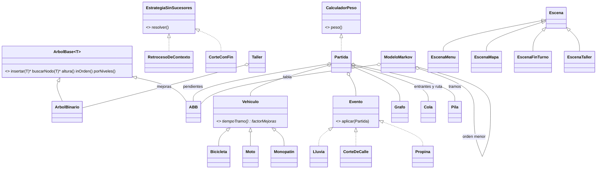

# Informe técnico — Repartidor en Resistencia

Juego 2D en Java 11+ (solo librería estándar). El cadete se mueve esquina por esquina por un mapa de calles
(algunas de una sola mano), acepta pedidos, entrega antes de la hora límite y gasta lo ganado en un taller.

**Cómo correrlo:** `compilar.bat` y después `ejecutar.bat juego.Main` (en Linux/macOS: `./compilar.sh` y `./ejecutar.sh juego.Main`).
Se ejecuta desde la carpeta raíz del proyecto, porque lee `datos/`.
**Pruebas:** `ejecutar.bat PruebaEstructuras` (40 comprobaciones), `ejecutar.bat verificador.PruebaMisEstructuras` (verificador del kit) y `ejecutar.bat PruebaMarkov` (salidas de Markov).

**Integrantes:** _(completar: una línea por persona, con nombre y paquete que programó)_

## 1. Controles

| Acción | Cómo |
|---|---|
| Elegir vehículo / empezar / taller | `1` `2` `3` / `ENTER` / `T` en el menú |
| Moverse | click en una esquina vecina (respeta las manos de las calles) |
| Ir a una esquina escrita | `TAB`, escribir `sarmiento y belgrano`, `ENTER` (el Trie sugiere calles) |
| Aceptar el próximo pedido | `A` |
| GPS (Dijkstra, −15 puntos) | `G` |
| Deshacer el último tramo (−30 s) | `Z` |
| Comprar una mejora | click en la caja dorada del taller |

## 2. Dónde decide cada estructura (nada está de adorno)

| Estructura | Uso en el juego | Por qué esta y no otra |
|---|---|---|
| **Lista** enlazada | Aristas del grafo, sucesores de Markov, hijos del Trie, resultado de todos los recorridos y de Dijkstra | Tamaño variable, se recorre en orden y casi nunca se accede por posición al azar |
| **Pila** | Tramos recorridos para **deshacer** (lo último que se hizo es lo primero que se deshace); in-orden iterativo del ABB | LIFO |
| **Cola** | **Pedidos entrantes** (el que llegó primero se atiende primero: es justo para el cliente), **ruta automática** de "ir hacia", BFS, recorrido por niveles y dibujo del árbol de mejoras | FIFO |
| **ABB de pedidos** | `minimo()` = pedido más urgente (se resalta en rojo y es el destino del GPS); entregar = `eliminar`; vencidos = mirar el mínimo; HUD = in-orden iterativo | Orden por hora límite con inserción y borrado O(log n) |
| **ABB de ranking** | Ranking ordenado de mayor a menor puntaje (menú y fin de turno) | Se guarda y se recarga ya ordenado |
| **ABB de Dijkstra** | Lista de prioridad `EntradaDistancia` (distancia, índice) con entradas "perezosas" | Cumple el rol de la cola de prioridad |
| **ABB de Markov** | Tabla de transiciones `EntradaMarkov` (estado → sucesores) | Búsqueda por estado en O(log S) |
| **Árbol binario de mejoras** | Qué mejora se puede comprar (solo si el padre está comprado) y el factor de velocidad total, que cambia los pesos que usa Dijkstra | Pre-orden para guardar, por niveles para dibujar, in-orden para listar, post-orden para sumar el costo de una rama |
| **Trie + Tokenizador** | Interpretar "9 de julio y belgrano" y autocompletar | Coincidencia más larga: "9 de julio" no se corta en "9" |
| **Grafo** | El mapa; Dijkstra (GPS y tiempo óptimo para puntuar), BFS (radio donde aparecen pedidos y ruta por cuadras), componentes conexas (pedidos que se cancelan tras un corte) | — |
| **Markov** | Nombres de clientes (k=3), reclamos (k=4) y avisos de la radio (k=4) | — |

## 3. Arquitectura (sin dependencias circulares)

```
estructuras ← arboles ← tokens, grafos, markov ← juego.reglas ← persistencia ← juego.pantallas ← juego.Main
```
Las estructuras genéricas no conocen al juego. `grafos` calcula pesos a través de la interfaz `CalculadorPeso`, que implementa
`Partida` (lluvia + vehículo + mejoras): así Dijkstra usa los tiempos reales sin depender de `juego.reglas`.



**Requisitos de POO:** clase abstracta con 3 subclases (`Vehiculo`: bicicleta, moto, monopatín, que calculan distinto el tiempo y la
lluvia); interfaces implementadas por varias clases (`Evento`, `EstrategiaSinSucesores`, `Comparable`); encapsulamiento con validación
en constructores y setters (`Esquina`, `Pedido`, `Mejora`, `Arista`, `EntradaRanking`, `Vehiculo.setFactorMejoras`); sin `instanceof`
(los eventos y los vehículos se resuelven por polimorfismo); excepciones propias (`CalleInexistenteException`, `PedidoVencidoException`,
`MovimientoInvalidoException`, `ArchivoDanadoException`).

## 4. Complejidad (Big-O)

| Operación | Costo |
|---|---|
| Lista enlazada: agregar al final / obtener(i) | O(1) / O(n) (con caché del último acceso, recorrer en orden es O(1) por paso) |
| Pila y Cola: apilar, desapilar, encolar, desencolar | O(1) |
| Árbol binario: recorridos, altura, nodos, hojas | O(n) |
| ABB: buscar, insertar, eliminar | O(h): O(log n) promedio, O(n) en el peor caso (datos ordenados degeneran en lista) |
| Trie: insertar o buscar una palabra de largo m | O(m·σ) (σ = hijos por nodo, guardados en una Lista) |
| Tokenizar un texto de n caracteres | O(n·L) en el peor caso (L = largo del token más largo) |
| BFS y DFS (lista de adyacencia) | O(V + E) (más O(V) por la búsqueda en la Lista de visitados) |
| Dijkstra con ABB como cola de prioridad | O((V + E)·log V) promedio; O((V + E)·V) si el ABB degenera |
| Componentes conexas | O(V + E) más el chequeo de aristas entrantes, O(V) por vértice |
| Markov: entrenar N caracteres / generar L | O(N·log S) / O(L·(log S + grado)) |

**Lista de adyacencia y no matriz:** un mapa de calles es un grafo disperso (cada esquina tiene 2 a 4 vecinos, E ≪ V²). La matriz
gastaría V² celdas casi vacías; la lista guarda solo las E aristas reales.

## 5. Formato de los archivos (`datos/`)

Las líneas que empiezan con `#` son comentarios (salvo la línea que es solo `#` en `mejoras.txt`, que marca un nodo vacío).

| Archivo | Formato | Ejemplo de línea |
|---|---|---|
| `mapa.txt` | `V;id;calle1;calle2;x;y` y `A;origen;destino;minutos`. La primera esquina es el local (UTN). Una mano = una línea A, doble mano = dos | `V;1;belgrano;french;90;90` / `A;1;2;0.6` |
| `mejoras.txt` | Árbol en **pre-orden**, `#` = vacío. Opcional `@dinero;N` | `Motor;200;0.9;false` |
| `corpus_clientes.txt` | Secciones `[NOMBRES]`, `[RECLAMOS]`, `[RADIO]`, una entrada por línea (180 nombres, 41 reclamos, 16 avisos) | `Lucia Gomez` |
| `ranking.txt` | `nombre;puntaje;entregas;fecha` (se guarda en orden de ranking) | `Lucia;2350;14;2026-11-25` |

**Tolerancia a fallos:** si un archivo no existe se usan datos por defecto definidos en el código (mapa de 6 esquinas, árbol de mejoras,
corpus mínimo, ranking vacío) y el juego sigue; una línea dañada se saltea y se anota un `ErrorCarga` (archivo, número de línea y
motivo) que se muestra como **Avisos** en el menú. Antes de sobrescribir `ranking.txt` o `mejoras.txt` se copia el anterior a `.bak`.
Toda lectura y escritura usa try-with-resources, y `java.io` solo aparece en el paquete `persistencia`. No se usa serialización
ni `java.nio`.

## 6. Markov: comparación de k = 1 a 4 (semilla fija, 10 salidas por k; completo con `PruebaMarkov`)

Nombres (180 líneas de corpus):

| k | Estados | Ejemplos |
|---|---|---|
| 1 | 49 | `Penariasaba`, `Topenco Lez`, `Julindreguicunala` — ruido casi puro |
| 2 | 263 | `Camilina Nunez`, `Godozonelala Boga` — suena a nombre, pero inventa sílabas |
| 3 | 594 | `Diego Maidana Diaz`, `Ivan Ramirez`, `Carolina Galarza` — nombres plausibles, algunos cortados |
| 4 | 844 | `Thiago Ibarra`, `Micaela Herrera`, `Mateo Gonzalez` — **copia nombres del corpus** |

Reclamos (41 líneas): k=1 `Sella quego quisivuborrepa ana len...` (ilegible); k=2 `Pedidos ya moja`; k=3 frases cortas con saltos raros (`El helado`,
`Con cebolsa`, `Nunca me es comidad en trajeron de se peraba mojada`); k=4 `Se me enfrio la plata`, `Me cobraron la puerta equivocada` — gramática casi correcta con mezclas graciosas.

**Conclusión:** con k chico el texto es ruido, con k grande el modelo copia el corpus. Se eligió k=3 para nombres (variedad suficiente y
legibles) y k=4 para reclamos y radio, donde el corpus es chico y k menor produce texto ilegible.

## 7. Decisiones de diseño

- **Duplicados en el ABB:** el ABB nunca guarda dos claves iguales (el duplicado se ignora). Por eso cada clase resuelve el empate en su
  `compareTo`: `Pedido` desempata por id, `EntradaRanking` por entregas, nombre y fecha, `EntradaDistancia` por índice de vértice.
- **Estados sin sucesores en Markov:** estrategia por defecto `RetrocesoDeContexto` (prueba con k−1, …, 1 usando los modelos de orden
  menor, entrenados a la vez); si llega a k=1 sin sucesores corta con fin. Alternativa: `CorteConFin`. En la práctica un estado sin
  sucesores solo aparece con un modelo sin entrenar; en ese caso `generar` reintenta 10 veces y devuelve un valor por defecto, nunca vacío.
  Si se llega al largo máximo sin encontrar el fin, se corta en el último espacio y se agrega `...`.
- **Texto escrito:** `Entrada` del kit solo informa teclas, así que `CajaTexto` convierte códigos de tecla en letras, números y espacio.
- **Tokens desconocidos:** una palabra que no está en el vocabulario genera un token `?palabra` que cubre hasta el próximo espacio (en
  lugar de avanzar un solo carácter, que dejaría tokens basura).
- **"Ir hacia" vs. GPS:** escribir un destino usa BFS (menos cuadras, ignora los tiempos); el GPS usa Dijkstra (menos minutos, con lluvia,
  vehículo y mejoras). Por eso el GPS cuesta puntos y mejora la eficiencia.
- **Corte de calle:** solo se corta si el jugador conserva al menos la mitad del mapa (se calcula con las componentes conexas); los pedidos
  que quedan aislados se cancelan sin penalización.
- **Tiempo:** 1 minuto de juego = 6 segundos reales; un turno dura 12 minutos de juego (72 s).
- **Puntaje:** entrega a tiempo +100 más 10 por minuto sobrante, más `100 × min(1, óptimo/real)` de eficiencia; GPS −15; pedido vencido −50;
  deshacer cuesta 30 s del turno.
- **Mapa:** 30 esquinas (5 calles este-oeste × 6 norte-sur) con 4 calles de una mano. Los nombres de calle y su disposición son
  una aproximación del centro de Resistencia: conviene revisarlos contra un mapa real antes de la entrega.

## 8. Checklist de restricciones (verificado)

- Sin colecciones de `java.util` (solo `java.util.Random`), sin `Arrays`/`Collections`/streams, sin `java.nio` ni `Serializable`.
- Los arreglos `[]` solo aparecen en `main(String[] args)` y en el `String[]` que devuelve `split` al leer una línea de archivo.
- Sin `instanceof` en el código del juego (los `equals` usan `getClass()`).
- Sin dependencias circulares (ver sección 3).
- Recursión con caso base explícito en los árboles, el DFS, el árbol de mejoras y su archivo.
